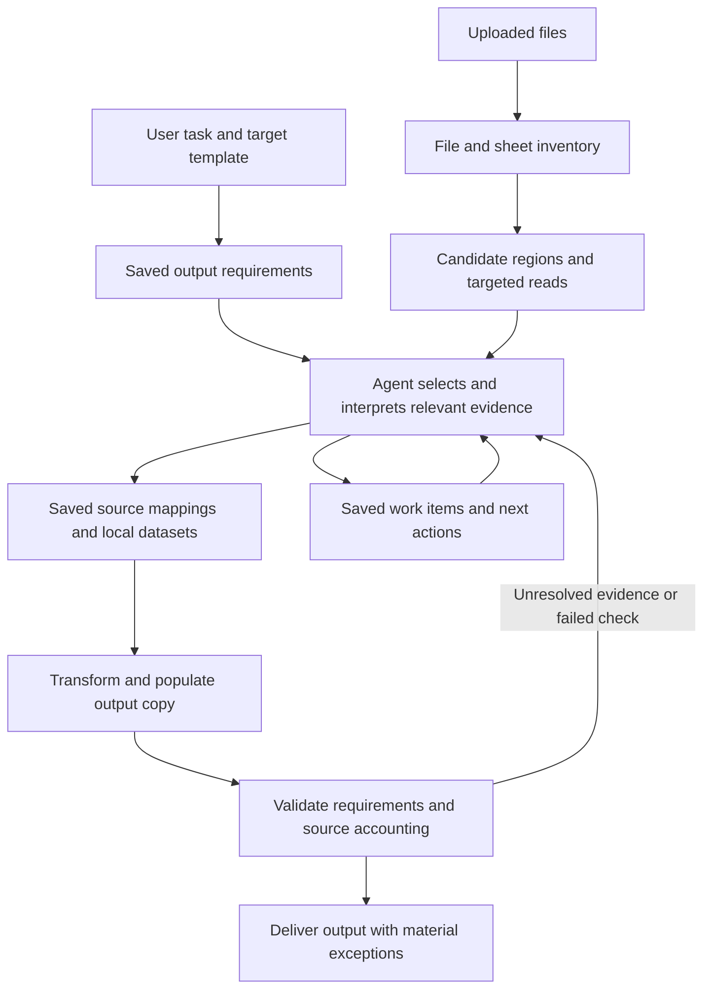

# Robust document agent harness and workbook processing plan

Date: 19 October 2026  
Status: Proposed implementation plan for review

Robustness across varied inputs and outputs is the primary design requirement. The application needs a durable agent harness that supports repeated inspection, action, verification and repair, preserves useful work across interruptions, and intervenes when the agent loses direction. Workbook processing is the first implementation of that harness.

The user’s task and supplied destination template, when present, define the required result. Uploaded files provide possible evidence. The agent should locate relevant information, interpret unfamiliar layouts, populate a usable output, and explain material gaps. Files, sheets and tables that do not contribute to the task may be excluded with a supported reason.

This plan extends the [existing product plan](single-agent-document-intelligence-plan.md) following the first reported Windows enterprise run. It proposes improvements to discovery, source accounting, persistent planning, context management and progress reporting. It retains one owning agent, the existing local workspace and SQLite storage, and the current bulk processing tools. Implementation is a separate step after review.

## 1 Context and evidence

The reported run repeatedly revisited discovery and reached the application’s request allowance without producing an output. The supplied screenshots describe frequent context rebuilding and no advance in record assignments. They also report a mismatch between the selected processing period and a source filename. That mismatch requires investigation; a filename alone does not establish the correct period.

Local inspection and synthetic checks established the following:

| Finding | Evidence and implication |
| --- | --- |
| The agent receives a business objective | The payroll module profile and runtime instructions describe preparation, reconciliation, evidence and validation. An empty additional task field does not mean there is no task. See [store.py](../../app/store.py) and [runtime.py](../../app/runtime.py). |
| Alternating discovery can escape the stop condition | A two-tool cycle paused at request 9. A three-tool cycle reached a test allowance of 24 requests (the configured default is 60) with zero context rebuilds. A separate four-tool cycle also reached its allowance. The current guard needs five matching fingerprints within ten actions, so a cycle of three or more tools can never trigger it. See [tools.py](../../app/tools.py). |
| The guard fingerprint includes the tool result | Results that carry changing counters, such as a revision or scanned-cell count, produce a new fingerprint on every call. Repeated re-inspection can therefore evade even the two-tool case. The three-repeat warning is recorded as a job event but never shown to the model, so there is no in-loop nudge before the pause. |
| A timed-out tool can hold the job indefinitely | After cancellation, the tool boundary keeps waiting for the worker thread and retains the job lock. The same wait absorbs the job-level timeout, so a parser that never returns appears able to hang the job permanently. This is a hard hang rather than a stall. See [tools.py](../../app/tools.py). |
| Context rebuilding has a plausible source of pressure | Without cached tokenizer assets, the estimator counts UTF-8 bytes as tokens. History rebuilding can start at 70 percent of the usable application budget. Local synthetic execution also used this fallback. The Windows trace is still needed to establish its role in that run. See [context.py](../../app/context.py). |
| Saved state lacks a required working plan | The continuation snapshot includes instructions, coverage, datasets, mappings, tasks and optional memory. It has no required current work item or next action. See [state.py](../../app/state.py). |
| Discovery creates a mixed backlog | Three employee rows plus their header produced four pending observations. Populated rows are not necessarily business records. See [inventory.py](../../app/inventory.py). |
| Revision changes are not sufficient proof of progress | Re-inspecting an unchanged workbook increased the revision and scanned-cell count without discovering additional rows. A guard based only on revisions would give false reassurance. |
| Bulk processing already works at a useful scale | The existing 5,000-row by 30-column test passed, along with three relevant context and failure-handling tests. This checks local tool behavior, not autonomous interpretation of a real submission. See [test_harness.py](../../tests/test_harness.py). |

The synthetic cycles used scripted models. They demonstrate that the harness permits a loop; they do not explain why the Windows model selected those actions. Context compaction may amplify a stall, but the guard failure exists independently.

## 2 Intended behavior

Consider a destination workbook requiring employee IDs, payment codes, amounts and effective dates. The submission includes a workbook with a title and logo, ten introductory rows, two tables on one sheet, a hidden lookup tab, and several unrelated historical reports.

The agent should establish the output requirements, locate candidate source regions, inspect their meaning, select the applicable data and write the destination. It should use the lookup where relevant and record why historical reports are outside the task. It should not create a separate employee-processing obligation for every introductory or lookup row.

An illustrative interpretation is:

| Source location | Meaning established by inspection | Treatment |
| --- | --- | --- |
| Rows 1 to 10 | Title, instructions and graphics | Retain relevant instructions and identify visual content needing inspection |
| A12:F240 | Current-period employee payments | Confirm headers and boundaries, then extract applicable records |
| H12:K35 | Payment-code reference table | Use as reference evidence; do not copy its rows as payments |
| Hidden Codes sheet | Possible authoritative code definitions | Inspect and resolve authority against the template guidance |
| Prior-year report | Outside the requested period | Exclude with period evidence, unless needed for a stated comparison |

The model can revise this interpretation when new evidence appears. A region proposal is a suggestion, not a fact about the workbook.

## 3 Scope and operating principles

The harness architecture must accommodate varied source formats, destination structures and business tasks. The first delivery targets native `.xlsx` outputs and supported mixed document evidence. Its workbook tools should support multiple sheets, stacked and side-by-side tables, multi-row headers, repeated headers, subtotals, merged cells, sparse formatting and irrelevant inputs. Additional output formats require their own writers and validators; this plan does not assume the current workbook writer can produce them.

The existing owning agent continues to select actions. A saved stage describes its current focus; it does not impose a fixed planner/extractor/reviewer pipeline. Independent records should continue while one region or business question is blocked. Ordinary interpretation, reading and draft creation require no new approval screens.

The application owns file access, stable references, local computation, persistence and validation. The model owns task interpretation, semantic mapping, source selection and resolving ambiguity from evidence. Deterministic layout detection helps locate candidates but cannot establish that an ambiguous “Amount” means the required payment amount.

No vector database, new workflow engine, arbitrary model-authored Python execution, mandatory delegation, or automatic reuse of unconfirmed business rules is required. SQLite remains appropriate for the current single-process deployment. Native Excel recalculation and preservation of every advanced workbook feature remain separate capability constraints.

### 3.1 General harness responsibilities

Use the coding-agent work pattern as the reference: examine the workspace, select a bounded next action, make a recoverable change, inspect the result, run appropriate checks, and repair failures. The agent can loop through this pattern many times and change approach as evidence develops. Iteration is essential; uncontrolled repetition is a harness failure.

Keep the following responsibilities independent of spreadsheet or payroll concepts:

| Harness responsibility | Required behavior |
| --- | --- |
| Task contract | Retain the requested outcome, scope, constraints, material questions and acceptance checks; support several deliverables and tasks without a supplied template |
| Capability discovery | Know which readers, search tools, transforms, writers and validators are available; expose unsupported capabilities early |
| Workspace and artifacts | Preserve originals, give artifacts stable versioned references, and allow bounded access to saved evidence |
| Work loop | Restore the current work item, choose an action, inspect its observed result and decide whether to continue, revise the plan or repair |
| Execution control | Enforce operation deadlines, cancellation boundaries, bounded error-specific retries and shared request/time allowances |
| Continuity | Checkpoint completed operations, reconcile interrupted writes and resume after context replacement or process restart |
| Progress supervision | Detect repeated results, alternating cycles, aimless exploration and repeated failed repairs without penalizing useful investigation |
| Verification | Require format-appropriate checks against the requested result and current artifact versions |
| Communication | Explain observed progress, blockers and recovery actions; preserve a usable draft when completion is not possible |

Readers and writers are format capabilities plugged into this loop. The core supervisor should not need to know an Excel row number to determine whether work advanced. Business profiles add domain rules without creating a separate agent runtime per module.

Define this boundary as a written contract in Phase 1b, before region work begins, so that “general” does not drift into “workbook-shaped”. Every format capability returns the same envelope:

| Field | Meaning |
| --- | --- |
| Artifact references | Stable, versioned IDs of anything read, created or changed |
| Evidence locations | Opaque, format-specific locators with a source content hash; the supervisor compares them but does not interpret them |
| Continuation cursor | Present when work stopped early, with the reason it stopped |
| Error class | One of the categories in section 7.1, plus a human-readable detail |
| Validation result | Checks run, passed, failed or uncheckable, with the artifact versions checked |
| Progress events | Zero or more of the application-issued event types in section 7 |

The supervisor, work plan and progress policy live in their own modules and depend only on this envelope. Workbook modules implement it; they do not host the generic logic.

Before acting, the agent must have a bounded objective for its next work item. After a tool result, it must be able to continue from the observed outcome, revise a falsified interpretation, investigate an actionable error or record a blocker. A missing capability becomes a concrete limitation or supported alternative, rather than an excuse to keep invoking adjacent discovery tools.

The initial implementation can remain within the existing runtime and fact store. A new orchestrator service or mandatory agent graph would add complexity without supplying these guarantees.

## 4 Processing model

### 4.1 Establish output requirements

Inspect the destination instructions, actual input areas, header bands, formulas, validation lists and reference tabs. Save an output specification containing:

- The requested entity, period and scope, with unresolved interpretations identified.
- Destination sheets and writable areas, including repeated forms or separate sections.
- Field meanings, required fields, identifier formats and allowed values.
- Formula and reference areas that must be preserved.
- Applicable business checks, including which totals should reconcile and why.
- Evidence for each interpretation and the current instruction/template versions.

The template is evidence about structure and meaning. User instructions govern authorized scope; material conflicts between instructions and template guidance become explicit questions. Not every blank cell must be filled, and a pre-existing value is not automatically correct or authorized to overwrite.

The specification can start incomplete. An unclear payment code must not prevent the agent from inspecting independent employee IDs or creating a recoverable draft.

### 4.2 Discover sources in layers

Start with file metadata and sheet names, visibility, declared table ranges, used-cell bounds and inexpensive summaries. Discovery must reveal hidden sheets and content beyond initial previews, while keeping values returned to the model bounded.

Separate structural indexing from record accounting. Scanning occupied cells creates an index and candidate regions; it does not immediately label every occupied row an unprocessed business record.

For each sheet, combine available clues: declared Excel tables, blank gaps, changes in column occupancy, repeated labels, merged header bands, formula bands, number formats and text/numeric patterns. Sample around likely boundaries rather than returning only the beginning of the sheet. Blank rows can occur inside tables, and different tables can touch, so proposals may overlap or remain uncertain.

Cache the structural index by source content hash and parser/index version. Repeating the same complete inspection returns the existing result without increasing discovery progress. A partial scan returns a durable continuation cursor and the reason it stopped.

Use bounded time/cell work units, cancellation checks and resumable indexing. The current reader opens a normal-mode workbook before its scan budget can stop it; this still needs measurement on sparse or very large files. Prefer a streaming index where compatible, with richer targeted reads for merges, styles and other metadata. Report an unsupported or oversized file clearly rather than treating an incomplete index as complete.

### 4.3 Locate and inspect regions

Provide a region query that returns coordinates, proposed type, header candidates, representative values, boundary clues, unresolved alternatives and any unclassified occupied spans. Keep large indexes in local storage.

Provide a bounded cell-search capability across indexed sheets, including normalized header text and coordinates. An agent looking for “Employee ID” must be able to find row 37 without requesting every preceding row. Search returns matching locations and nearby context; it does not claim to understand synonymous business fields or prove that all applicable records were found.

Extend targeted reads to return multi-row header bands and enough metadata to interpret merges, formula/value distinctions, identifiers and nearby notes. Let the agent split, merge, resize or reject proposals. Declared Excel table boundaries are useful hints and may still contain totals or incomplete data.

For scattered form-like content, support selected source cells and document observations as evidence rather than forcing everything into a rectangular table.

### 4.4 Select relevant sources

Classify files, sheets or regions as contributing records, reference material, instructions, outside scope, unresolved, or unsupported. A decision includes its scope, rationale, evidence and instruction version.

An entire clearly irrelevant file may be excluded without fully extracting every record. Its exclusion still needs sufficient evidence: verified period or entity information, explicit user guidance, or an inspected content summary. Filename and sheet-name matches are discovery hints. A broad exclusion is rejected or reopened when it conflicts with an existing applicable mapping or new instructions.

An inspected sheet must account for remaining occupied regions at a useful level. The agent may group a title band or irrelevant historical section into one decision. Material unclassified regions remain open. This preserves omission checks without requiring individual decisions for thousands of decorative cells.

An unreadable source can remain a reported limitation when unrelated work continues. If it could materially affect the required output and relevance cannot be resolved, the result remains partial or requires clarification.

### 4.5 Extract and normalize selected data

Save a source mapping with region coordinates, header interpretation, column roles, data types, filters, period rules, join keys and supporting evidence. Flatten multi-row headings into meaningful fields while retaining their original coordinates. Make unpivoting of monthly or category columns a bounded typed transformation where the acceptance corpus requires it.

Use local extraction and the existing typed transformation operations for the full selected region. Retrieve representative values, distributions and exceptions for model review. Preserve identifiers and distinguish raw formulas from cached results. A missing formula cache remains unresolved unless an explicitly supported calculation route supplies the value.

Extraction must accommodate many input records producing one output record, one input record producing several output records, and reference rows supporting multiple outputs. These relationships need explicit mapping semantics; simple row-count equality cannot establish completeness.

### 4.6 Write and validate the destination

Reuse output copies, source evidence, output journals and idempotent operation IDs. Populate only established destination areas. Preserve existing protections for formulas, types, retained cell provenance and stale mappings.

Validate the current output against the saved requirements and applicable source mappings. Reconcile relevant records, required values, identifiers, allowed codes, duplicates, specified totals, period/entity and workbook integrity. Record which requirements were checked, passed, failed or remained uncheckable.

Completion requires a valid current output, satisfied material requirements, accounted relevant records, justified exclusions, and no material unknown source scope. A model-authored specification cannot prove its own completeness: include a destination-wide check that every discovered potential input area is classified as required, optional, reference, preserved or unresolved. Uncertainty about its meaning remains visible.

Unknowns that prevent full completion should still allow a useful partial workbook. A failed optional preview or report must not discard that workbook.

## 5 Region and record accounting

The current observation identity uses a file, sheet and worksheet row. That is insufficient when two independent tables share a worksheet row. Excluding a row in the reference table must not exclude a payment on the same row in the main table.

Introduce a stable region identity and a record identity within an accepted extraction mapping. Region records retain precise source cells, their source content hash and their mapping revision. A changed region boundary creates a new mapping revision; prior assignments are reconciled and become stale where affected.

Overlapping candidate regions are allowed during discovery. Accepted mappings must identify deliberate overlaps, shared reference evidence and duplicate extraction of the same business facts. The agent must not silently count two competing interpretations twice. Completeness and duplicate checks must inspect actual contributions, not only region IDs.

Keep three separate measures:

| Measure | Meaning |
| --- | --- |
| Discovery coverage | What files, sheets and occupied areas have been indexed or remain unknown |
| Task scope coverage | What is applicable, supporting, excluded, unresolved or unsupported, and why |
| Output coverage | What accepted business records have been written, deliberately filtered, aggregated, held or remain pending |

Reference rows may support a mapping without receiving their own output assignment. Structural content receives region-level treatment. Decisions affecting record inclusion need source evidence and must be re-evaluated when relevant instructions change.

## 6 Durable working plan

Add a persisted plan that the agent updates through a small typed interface. Tool outcomes automatically attach concrete results; narrative claims cannot mark extraction, writing or validation complete.

| Plan element | Purpose |
| --- | --- |
| Objective and versions | Current task, entity, period, template hash and instruction revision |
| Current focus | For example, interpreting the payments region or resolving unmatched employee IDs |
| Work items | Bounded tasks with dependencies, source scope, status, results and evidence |
| Next actions | A small prioritized list with relevant tool arguments or artifact IDs |
| Established decisions | Header meanings, source authority, exclusion reasons and mapping versions |
| Blockers | Specific missing evidence or questions, with affected output requirements |
| Current artifacts | Dataset revisions, output path/hash, journals and validation results |
| Progress checkpoint | Useful changes since the prior checkpoint and remaining work |

Stages such as understanding the destination, discovery, interpretation, writing and validation are descriptive. The agent can revisit a stage and process independent regions in any useful order. It should not need to rewrite a plan after every minor read.

The plan and its attempted-approach record must stay bounded, or the continuation will recreate the context pressure it is meant to relieve. Set hard limits on open work items, next actions and attempted approaches carried into context. Completed and superseded items move to queryable history. Attempted approaches are summarized per work item, keeping the most recent outcome and a count, rather than appended without limit. The application, not the model, enforces these limits.

On compaction or restart, inject a bounded continuation containing the objective, current focus, next actions, blockers and references to durable artifacts. Keep detailed plans and data queryable by ID. A generic “discover sources” instruction should not become the default next step after every rebuild.

New user instructions invalidate the affected requirements, decisions, work items, mappings and derived datasets through explicit dependency links. Recover any pending output operation before replacing its interpretation. Retain the existing distinction between settling an interrupted commit and authorizing its business rules for reuse.

## 7 Progress detection and recovery

Retain the current identical-call check as one signal, and add progress detection across completed model/tool turns. Observe activity from the owning agent and any existing workers without counting worker polling or task bookkeeping as business progress.

Progress is decided by the application, not by the model. Only the following event types, issued by tool code after checking actual state, count as useful change:

| Event | Credited when |
| --- | --- |
| Evidence inspected | A source location not previously inspected at this source version is read |
| Cursor extended | A scan cursor moves beyond its previous furthest position for the same source version |
| Interpretation settled | A region role or mapping is saved whose content hash differs from every earlier version for that region |
| Question resolved | A recorded material question or blocker is closed with linked evidence |
| Dataset changed | A dataset revision has different contents from its predecessor |
| Output assigned | New records gain output assignments in a committed output |
| Validation improved | A previously failing check now passes against the current artifact versions |

New evidence is deduplicated by source version and location. Rewriting notes, renaming tasks, repeating reads, incrementing counters or writing identical bytes does not reset the progress clock. Returning to an interpretation that was already saved and then replaced (A → B → A) counts as no progress, and repeated flips for the same region are reported as a stall signal.

Discovery and investigation need their own allowance: a turn can make useful progress before any output exists. Distinct reads are not unlimited permission to wander. Evidence-inspected credit is provisional: it becomes permanent only when a work item, requirement, interpretation or exclusion references that evidence within a configurable number of turns (initially six). Provisional credit that expires is withdrawn, so browsing many distinct cells without linking any of them eventually registers as no useful change.

There is one stall clock, not two. Provisional credit keeps the clock running for its window; if it expires unlinked, the turns it covered count as unproductive and the recovery policy below applies.

Workers follow the same rules, measured per worker, with their own credit counted only toward their delegated scope. Polling and task bookkeeping never count. A stalled worker is cancelled with its findings retained, as today, and the owning agent is told why.

Initial configurable policy for testing:

0. Immediately, and independent of the rest of this section: remove volatile counters (revisions, scanned-cell counts, timestamps) from the repeat fingerprint; detect repeating action cycles of up to five steps, not only identical calls; and return the existing early warning to the model as part of the tool result, not only as a job event.
1. After four completed owning-agent turns with no useful change, inject a recovery instruction before the next model request. Include the repeated actions, current work item and unfinished alternatives. Preserve a separate identical-action circuit breaker.
2. Give the agent up to two further turns to advance the task, identify a specific blocker, or ask a necessary question. These turns use the existing shared request/time allowance.
3. If the stall persists, pause with the last useful checkpoint, affected requirement, attempted recovery and available draft. Cancel or settle active workers using the existing lifecycle rules.

These numbers are starting settings to tune against acceptance runs. A whole discovery pass may span many work units, but each must produce a verified continuation or new useful evidence. Request/time limits remain final backstops. Repeated resumes must retain the unresolved stall history rather than silently authorizing the same discovery loop.

Recovery may focus the available action choices for the current work item. It must still allow a justified reread after changed instructions, source revisions or a changed interpretation. Do not globally disable discovery tools or force a write when the evidence is insufficient.

### 7.1 Error handling and changing strategy

Return structured failures that distinguish a transient service problem, invalid tool arguments, unsupported format, missing evidence, conflicting business facts and uncertain write completion. A transient error may receive a bounded retry with backoff. Invalid arguments require correction. Missing evidence requires another source or a targeted question. An uncertain write requires journal reconciliation before another mutation. Repeatedly invoking the same failed action without a relevant change is not repair.

Today every tool failure returns the Python exception class and one generic instruction. Adopting these categories means changing the failure path of every tool and mapping known exceptions to a category, with “unclassified” as an explicit fallback that is reported in diagnostics so it can be reduced over time.

Before repeating a failed approach, the agent should identify what changed: corrected arguments, another reader, a narrower region, different evidence or a revised interpretation. Persist a compact record of attempted approaches and their outcomes so compaction does not restart an already exhausted strategy. This is a record of actions and evidence, not private model reasoning.

A repair episode must end in verified improvement, a different supported strategy, an isolated blocker or an actionable pause. When one work item is blocked, continue independent work where available. Keep all repair calls, summaries and optional workers within the same job allowances; do not create unbounded nested retry loops.

### 7.2 Slow operations and resource limits

A model-turn counter cannot detect a tool that never returns. Apply deadlines and resource bounds at the tool boundary, with explicit continuation for operations that can be chunked. Heartbeats indicate that an operation is alive, not that the task is advancing. Combine turn-based stall detection with elapsed time, tool activity and the bounded objective; do not equate the same turn count with the same amount of work across jobs.

This is a Phase 1a requirement, not polish. The current tool boundary waits indefinitely for a timed-out thread and absorbs the job timeout while it waits (section 1), so one non-returning parser can hang a job permanently. For parsing or rendering code that cannot reliably observe cancellation, use an isolated worker process so the application can terminate the operation and reclaim resources. A timed-out thread must not keep mutating artifacts after the job has resumed. Keep writes journaled, serialized and recoverable; only report a job as stopped when any outstanding mutation is settled or explicitly tracked for recovery.

## 8 Context budgeting

Provision and verify tokenizer assets during setup, including an approved offline path for Windows enterprise installations. Expose the active estimation method in startup diagnostics. Installing a tokenizer package does not itself guarantee that its encoding data is available.

Keep the runtime free of unexpected tokenizer downloads. If an exact route-compatible tokenizer is unavailable, label the estimate and its uncertainty. Do not silently assume that one encoding exactly represents every enterprise model alias, or change a hard provider limit based on a single usage ratio.

Measure the fixed instruction/tool-schema floor separately from growing history. If essential material already exceeds the configured allowance, pause with configuration guidance instead of repeatedly rebuilding a history that cannot shrink enough. Compare estimates and reported input usage for the same request, distinguishing unavailable measurements and reporting cached-token details where supplied.

Apply cheap payload archiving first, then recalculate before deciding whether to rebuild. Preserve recent coherent tool exchanges and the current plan. Use different rebuild trigger and target levels to avoid immediate retriggering; record when a rebuild saved too little to be useful. Forced reduction for an actual provider context-length rejection remains a bounded recovery path.

Narrative summarization is optional and consumes the shared allowance. Failure must retain a deterministic continuation. Do not make another summary call merely because a prior summary left the same fixed context floor. Track the main agent, workers and summarization consistently in request diagnostics.

## 9 Workbook visual content

The current `view_page` supports PDFs and image files, not worksheet rendering. Neither `inspect_source` nor cell reads interpret embedded Excel graphics. A logo can be irrelevant; an embedded instruction image or screenshot can contain essential information.

First inventory embedded images, drawing anchors and relevant workbook feature metadata so these contents are not silently invisible. For embedded raster images, extract the original image as a scoped job artifact for the existing vision path, with its sheet and anchor recorded. An anchor identifies placement, not the business record to which the image belongs.

Use a focused capability spike to decide whether a worksheet renderer is needed for layout interpretation. Evaluate deployment feasibility, merged cells, charts, fidelity, temporary files, time limits and Windows enterprise setup. Renderer selection is a separate implementation decision; there is no assumed Office installation or cloud conversion service.

If visual content cannot be inspected and may materially affect the task, report the affected region as unresolved and continue independent work. Pixel extraction does not solve native Excel calculation or preservation of unsupported drawings.

## 10 Storage and tool interfaces

Keep [the current storage layout](../../README.md): application jobs/events in `data/jobs.db`, per-job facts in `working/state.sqlite`, and originals/working artifacts/outputs on disk under the job directory. Large indexes, datasets and images remain outside active model context. No new database service is needed.

Add versioned facts for output requirements, regions, source roles, extraction mappings, work items and progress checkpoints. Reuse existing datasets, decisions, instruction revisions and journals where their meaning fits. Do not overload the current flat worksheet-row identity for new region records.

Proposed model-facing capabilities are conceptual names to refine during implementation:

| Capability | Input and bounded result |
| --- | --- |
| Inspect destination | Sheet/area selection; potential input areas, fields, formulas and guidance |
| Discover source | File/sheet and continuation; cached structural summary and region references |
| Search cells | Scoped text/pattern query; coordinates, matched values and nearby context |
| Query or inspect regions | IDs, pagination and coordinates; boundary clues, samples and unresolved alternatives |
| Save interpretation | Source-backed region roles and mappings; validated references and affected dependencies |
| Update work plan | Focus, work items and next actions; resulting plan revision |
| Extract, transform and populate | Accepted mappings and typed operations; durable datasets and output commit results |
| Validate task | Current output and requirement versions; failures, exceptions and coverage by layer |

Prefer extending or replacing confusing existing tool contracts over continually adding near-duplicate tools. Bound tool schemas and result sizes as well as row counts. Return pointers and useful continuation instructions when results are truncated.

Use existing job locks and transaction boundaries for plan and region changes. Existing read-only workers may contribute scoped discovery and handovers; the owning agent accepts task scope and output mappings. A worker's summary does not establish reviewed evidence or completion for the owner.

## 11 Changes by code area

| Area | Planned responsibility |
| --- | --- |
| `app/inventory.py` | Cached structural indexing, continuation, candidate regions and explicit discovery completeness |
| `app/state.py` | Versioned requirements/plans/regions, dependencies, separate coverage measures and migration support |
| `app/harness_tools.py` | Bounded discovery/search/interpretation/plan interfaces and task-level validation |
| `app/datasets.py` | Region-aware record IDs, evidence, extraction boundaries and required normalization operations |
| New supervisor/work-plan modules | Capability envelope, work plan, progress events, stall policy and recovery, depending on no format-specific code |
| `app/tools.py` | Normalized repeat fingerprint and cycle detection, model-visible warnings, categorized failures for every tool, isolated execution for non-cancellable work, targeted reads and embedded-image access |
| `app/context.py` | Tokenizer health, fixed-cost estimates, recalculation, stable continuation and rebuild diagnostics |
| `app/runtime.py` | Plan restoration, recovery intervention, final requirement checks and structured progress events |
| `app/delegation.py` | Shared budgets, scoped discovery, stall handling and dependency-aware handovers |
| `app/main.py` and `web/` | Additive status/diagnostic fields and concise progress presentation |
| Startup scripts and configuration | Offline tokenizer provisioning, validated settings and capability diagnostics |
| `tests/` and acceptance scripts | Ground-truth fixtures, loop/recovery regression tests and end-to-end evaluation |

Extract focused region-index or progress-policy modules if these responsibilities would otherwise make existing files difficult to understand. Introduce interfaces around durable facts and semantic events rather than coupling the progress guard to raw database writes.

## 12 User experience

Keep the existing preference for minimal interface copy. The main view should show current focus, the latest useful accomplishment, any blocker and available output. Detailed counters belong in Diagnostics.

Example activity:

> Found two tables on Payments. Confirmed the payment table starts at row 14. Extracting 226 candidate payments; the adjacent code table will be used as reference data.

Example blocked state:

> Prepared 218 payments. Eight records have conflicting effective dates. The selected period is October, while the source content identifies February; confirmation is needed before finalizing those records.

Counts must reflect actual saved results. Show discovered regions, applicable records, held records and written output separately. Do not display a completion percentage until its denominator is known. A discovery pause must explain why no output exists yet.

Diagnostics should correlate request number and actor, current work item, tool/region, useful change, repeated-action status, context estimate/method, rebuild reason and reported usage. Include the parser/index, application and configuration versions in diagnostic exports so Windows runs can be compared with local reproduction. Continue excluding credentials and raw image bytes from routine logs.

## 13 Delivery sequence

| Phase | Deliverable | Exit condition |
| --- | --- | --- |
| 0 Capture the baseline | Small reproducible discovery cycles, a messy-workbook fixture pack and the approved Windows diagnostic bundle when available | Failures can be repeated; confirmed mechanisms are separated from model-behavior hypotheses |
| 0.5 Correct the existing guard | Volatile counters removed from the repeat fingerprint, cycle detection up to five steps, model-visible early warning | Three/four-tool cycles and repeated re-inspection pause or are warned before the cap; existing tests still pass. Ships independently, without waiting for the Windows export |
| 1a Make execution bounded | Isolated execution for non-cancellable tools, categorized failures across all tools, tokenizer setup and context diagnostics | A non-returning tool is stopped and the job ends or resumes without an untracked write; failures arrive with a category |
| 1b Establish the general work loop | Capability envelope contract, bounded work-plan persistence, application-issued progress events, single stall clock and bounded recovery | Failed approaches change or stop; useful investigation continues; wandering without linked evidence stalls; plan survives rebuild and restart; a non-spreadsheet test adapter passes the same supervision tests |
| 2 Discover and interpret regions | Structural cache, search, region proposals/edits and richer targeted reads | Data below introductions, stacked tables and side-by-side tables are locatable without sequentially reading whole sheets into context |
| 3 Connect scope to output | Destination requirements, region identities, source-role decisions, extraction mappings and revised validation | Relevant records are accounted; justified irrelevant regions do not create output obligations; unknown material scope prevents false completion |
| 4 Handle visual evidence | Image inventory/extraction and renderer decision spike | Embedded instructions are inspected when supported, otherwise explicitly unresolved; independent output remains available |
| 5 Validate the complete agent | End-to-end fixture runs, fault injection and representative Windows enterprise acceptance | Correct output and recovery are demonstrated on the approved route and representative files |

Phase 0.5 is a small change and should land first. Phases 1a and 1b provide broader reliability improvements but do not complete messy-workbook support. The region schema and migration contract should be sketched before Phase 1b so work-item references do not need a second redesign. Phases 2 and 3 should land in small vertical slices: discover a region, interpret it, extract it, write it and validate it before adding more layout heuristics.

No calendar estimate is asserted before baseline fixtures and the visual capability spike establish the work. Keep reviewable changes small and retain a working end-to-end path between phases.

## 14 Acceptance criteria

Create synthetic fixtures with hand-authored expected regions, source roles, field values, excluded areas and output checks. Include held-out variants so hard-coded coordinates cannot satisfy the evaluation.

| Scenario | Required result |
| --- | --- |
| Ten or more introductory rows; data begins well below the first preview | Locate the data and distinguish instructions from records |
| Two vertically stacked tables with different headers | Extract the applicable table or both when required; preserve their meanings |
| Two side-by-side tables sharing rows | Independent identities, mappings and exclusions; no accidental loss or duplicate inclusion |
| Multi-row/merged headers, internal blank rows and repeated headers | Correct field interpretation and boundaries; no header as employee/payment |
| Totals, subtotals and formulas | No double counting; missing formula caches remain explicit exceptions |
| Hidden reference sheet and an irrelevant historical workbook | Use relevant reference evidence; exclude history with a supported reason |
| Ambiguous amount, entity or period | Investigate and ask a targeted material question; no fabricated choice |
| All inputs irrelevant or required evidence absent | Explain the missing requirement and return an honest partial outcome |
| Embedded instruction image or unsupported visual feature | Inspect supported pixels or identify the unresolved region; do not silently skip it |
| Sparse formatting, excessive dimensions and a bounded scan | No false completeness; resumable work units and cancellation |
| Duplicate files and overlapping region proposals | Reuse parsing without losing file occurrences; prevent duplicate business contributions |
| Many-to-one aggregation and one-to-many output mapping | Correct values and accounting across the declared relationship |
| Three/four-tool discovery cycles with and without compaction | Bounded recovery or actionable pause before request exhaustion |
| Legitimate investigation before output | New useful evidence progresses without a premature stall pause |
| Many distinct reads never linked to any requirement | Provisional credit expires and recovery starts before request exhaustion |
| Interpretation flip-flopping on one region | No progress credit for returning to an earlier version; stall reported |
| One long, legitimate extraction or index operation | No stall pause while the operation is alive and within its deadline |
| Model service failure or rate limit during a recovery episode | Bounded retry within the shared allowance; recovery state survives; no duplicate intervention |
| Narrative summary fails during recovery or compaction | Deterministic continuation is used; recovery proceeds |
| Repeated identical reads, reinspection, plan rewrites and identical output writes | No false progress credit |
| Repeated forced compaction and unavailable narrative summary | Same objective, mappings, blockers and next action remain retrievable |
| Mid-run instruction changes and restart during output commit | Only affected work invalidates; recovery creates no duplicate output |
| Repeated parser/validation failure with attempted repairs | Change the failing approach or isolate a specific blocker within a bounded allowance |
| Tool exceeds its deadline or ignores cancellation | Stop or isolate execution; no untracked background write or lost checkpoint |
| Unavailable reader, writer or calculation capability | Identify the precise gap and use an available alternative or report an honest limitation |
| Different destination layout or several requested deliverables | Restore the same general work loop; track and verify each deliverable independently |
| Existing large workbook and template-fidelity cases | Preserve current numeric/identifier handling, formulas, hidden tabs and operation recovery |

Use three evaluation layers. Offline tests exercise actual indexing, extraction, state, guard and journal code. Scripted-model tests exercise the runtime and intervention paths but cannot establish semantic understanding. Live agent runs on the approved model route evaluate autonomous source selection and mapping against ground truth; record the model alias, settings, requests, usage and exceptions.

Start with the existing offline suite and `scripts/harness_acceptance.py`, extending them for regions and fault injection. Treat failed or partial runs as failures where a fixture expects completion. Check actual workbook values and evidence, not only tool counts or final status.

Collect exact field/record accuracy, missed applicable records, unsupported inclusions, justified exclusions, operator corrections, useful progress per request and context rebuild behavior. On deterministic fixtures, require exact expected values and no omitted applicable records. Establish realistic live pilot thresholds from the hand-checked corpus before claiming production readiness. Fixed request counts are not a success metric across differently sized jobs.

Native Windows acceptance must cover startup with no tokenizer cache, offline provisioning, approved TLS/proxy behavior, Unicode/nested paths, restart and output opening in the user's Excel environment. A passing macOS synthetic run cannot establish these results.

Exercise core supervision with small test adapters that do not expose spreadsheet concepts, including successful work, changing evidence, a failed repair and interruption. This checks that the harness is reusable without claiming support for unimplemented production output formats. The end-to-end corpus should vary source and destination layouts independently so success cannot depend on one familiar source/template pairing.

## 15 Compatibility and rollout

Add schema versions and migrations that preserve existing files, decisions, instructions, assignments and journals. Test migration on copied job directories, including an old paused job and an interrupted output operation. Keep the old job export available before migration.

Legacy worksheet-row observations retain their original meaning; do not silently reinterpret them as accepted region records or declare old coverage complete. On resume, derive compatible region references where unambiguous and mark unresolved interpretation work explicitly. Existing artifacts remain downloadable.

Ship new discovery behind a per-job schema/feature version during development. A job stays on one accounting version unless explicitly migrated. Do not combine old and new coverage counters in the same completion verdict. Validation records include the specification, mapping, instruction and output revisions they checked.

Use fixture jobs first, then a representative approved enterprise submission with a hand-checked expected output. Compare diagnostics and inspect the deliverable. Broaden the pilot only after material omissions, unsupported values and recovery behavior satisfy the agreed criteria.

## 16 Tradeoffs and limits

Candidate-region detection cannot guarantee understanding of arbitrary spreadsheets. Its value is to expose useful locations and uncertainty so the agent can investigate. Region exclusions reduce administrative work but can conceal omissions if accepted too casually; discovery completeness, scope evidence and destination requirements must be checked together.

A saved plan can itself be wrong. It is a retrievable hypothesis with evidence and dependencies, while completed tool results establish actual work. More tools and metadata also increase schema/context costs, so bounded responses and a small coherent interface are part of the reliability work.

Visual rendering introduces deployment and fidelity costs. Extracting embedded raster images is a useful first capability, but it does not reproduce all visible worksheet content. Unsupported layouts or features must result in scoped limitations rather than invented certainty.

This work improves the local single-process application. Enterprise identity, shared multi-user storage, horizontal scaling and certified native workbook fidelity require separate designs.

## 17 Review decisions

The recommended defaults are:

1. Treat the general inspect, act, verify and repair loop as the architectural foundation; make workbook processing its first format capability.
2. Use the task and template to define completion; allow evidence-backed exclusions of irrelevant inputs.
3. Keep broad structural visibility, with detailed reading and extraction driven by relevance and material uncertainty.
4. Introduce region-based business records while preserving cell evidence and the existing write journal.
5. Let the agent revise its working plan without operator approval for every mapping.
6. Attempt one bounded recovery episode before pausing a persistent stall; retain the request/time cap and operation deadlines.
7. Include embedded-image discovery/extraction, and choose a worksheet renderer only after a focused capability test.
8. Preserve useful partial outputs and clearly distinguish their unresolved requirements.

The main product choices for review are below. They block the Phase 3 and Phase 4 fixtures, so each needs an owner and a date before Phase 2 ends.

| Open decision | Owner | Needed by |
| --- | --- | --- |
| Which source classes must always be reconciled, even when apparently irrelevant | To assign | End of Phase 2 |
| Which destination requirements are material blockers | To assign | End of Phase 2 |
| Which visual or advanced Excel features the initial pilot must handle | To assign | Start of Phase 4 |

Representative source/template pairs and expected results will turn those choices into acceptance fixtures. The Windows diagnostic export will refine the original-run diagnosis without blocking the independently reproduced guard correction.
