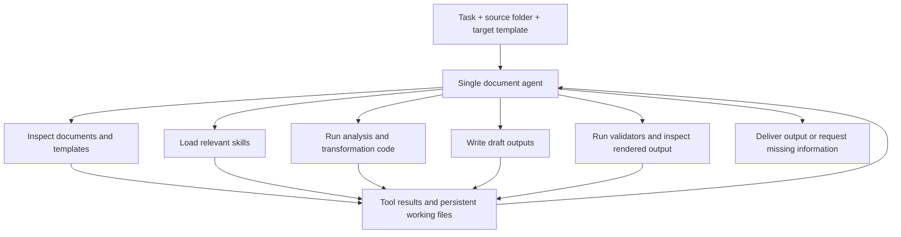

# Single-agent Document Intelligence: product and implementation plan

Date: 17 October 2026  
Status: Local MVP with harness hardening and optional delegated scouting implemented (18 October 2026)

Updated with nested-folder payroll requirements, a reliability-first operating policy, LLM vision for scans, Azure App Service hosting, and a proposed PydanticAI runtime. Sections 15–16 describe processing and memory. The local implementation now lives in `app/` and `web/`; `start.sh` and `start.bat` launch it. Azure deployment remains a future acceptance step.

A [local interactive frontend prototype](../../prototype/frontend/README.md) now explores module configuration, live activity, and diagnostics. Its processing and metrics are simulated. Section 17 records the module and observability design.

## 1. Product objective

Build an intelligent document-processing agent that accepts a folder of mixed source documents, task instructions, and a team-supplied output template. The agent investigates the submission, reconciles information, produces the requested deliverable, validates its work, and repairs failures.

Templates and business tasks can vary. The product should accommodate this variation through agent reasoning, tools, skills, and reusable task knowledge, rather than requiring a predefined processing pipeline for every task.

The initial deliverable is a prepared document or workbook. Posting transactions to downstream systems is outside the initial scope.

### Operating priority: useful results and resilient execution

Give the agent broad freedom to inspect, search, render, write scripts, populate drafts, check results, and repair its approach within the job workspace. Do not require approval for ordinary reads, transformations, or draft creation. Build the smallest working end-to-end loop first.

Retain checks that protect the result: preserve originals, avoid missing or duplicating records, protect essential template features, report unresolved material facts, and recover from tool failures. Capture source locations and progress automatically where practical. Exhaustive cell lineage, formal audit exports, approval workflows, and a complete feature-by-feature workbook certification are later enhancements, not prerequisites for a useful draft. A failed optional report or provenance write produces a warning and must not discard the output or stop unrelated work.

A corrupt file, missing optional capability, ambiguous record, or failed check affects the relevant work item. Continue independent work and return a usable partial result with clear exceptions. Scope and access boundaries remain application responsibilities; the model should spend its context doing the task rather than satisfying procedural bookkeeping.

## 2. Core architectural decision

Use **one agent that owns the task and dynamically chooses its actions**, supported by a robust execution harness.

The harness is the application code responsible for running the model/tool loop, maintaining job state, controlling tool access, preserving progress, and enforcing completion requirements.

Document readers, extraction utilities, spreadsheet tools, skills, and validators are capabilities available to the agent. They are not mandatory stages in a fixed workflow. The agent may inspect a template before reading the source files, revisit a document after finding a conflict, or create a script to transform unfamiliar data.

One agent can make many model calls, invoke tools repeatedly, and work across several context windows. A separate planner, extractor, reviewer, or critic agent is not required for the initial design.

The implemented harness now permits the owning agent to delegate bounded read-only scouting, investigation, or review on demand. Each worker has a separate persisted context, explicit file scope, no output-writing or recursive-delegation capability, and shares the job's time/request allowance. The default concurrency limit is two workers. The main agent continues to own reconciliation and completion; this does not introduce a mandatory planner/extractor/reviewer graph.



The diagram shows available interactions. It does not prescribe their order.

## 3. Inputs and outputs

### Inputs

| Input | Contents |
| --- | --- |
| Source folder | PDFs, Word documents, spreadsheets, images, emails, and supporting files, within the formats supported by the prototype |
| Output template | The team's existing workbook or document, including required structure and formatting |
| Task instructions | Desired result, processing period, scope, and relevant business instructions |
| Optional reference data | Employee or supplier masters, codes, purchase orders, and other authoritative registers |
| Optional task profile | Previously confirmed meanings, mappings, business rules, and output requirements |

An ambiguous heading such as “Amount” does not establish whether the field means gross, net, approved, or outstanding amount. The agent should investigate available guidance and request clarification when the ambiguity materially changes the result.

### Outputs

1. **Completed team template:** populated and validated against the applicable requirements.
2. **Exception report:** unresolved conflicts, missing information, held records, and unsupported inputs.
3. **Concise processing summary:** checks performed, material limitations, and available source references. Detailed evidence export is optional; its failure must not prevent download of an otherwise usable result.

Structured intermediate records should be retained for review and recovery. They need not be forced into one universal transaction schema covering every possible domain.

## 4. Agent working environment

Give each job a dedicated workspace containing immutable source copies, the original template, writable working files, draft outputs, and validation reports.

Suggested logical layout:

```text
job/
  inputs/                 # Preserved originals
  template/               # Preserved target template
  working/                # Scripts, mappings, intermediate records, notes
  previews/               # Rendered pages and workbook previews
  validation/             # Check results and evidence coverage
  outputs/                # Deliverables prepared for publication
```

Job status, tool events, checkpoints, and artifact metadata belong in durable application storage. Working notes help the agent resume, but do not replace the database or authoritative validation results.

The agent may create transformation scripts and additional tests. It should be able to inspect execution errors and resulting files, then revise its approach.

## 5. Tool capabilities

Start with a small, composable tool surface. Add specialized tools when recurring failures demonstrate a need.

| Capability | Example operations | Useful feedback |
| --- | --- | --- |
| Explore | List files, inspect metadata, search content | File inventory, unreadable files, duplicate hashes |
| Read documents | Extract text/tables, render PDF pages, inspect email attachments | Content with file, page, region, or text-span references |
| Read spreadsheets | Inspect sheets, cells, formulas, hidden content and tables | Native coordinates, formulas and available cached values |
| Compute | Execute Python against job files | Exit status, errors, structured results and generated artifacts |
| Edit templates | Modify copies of Word/Excel files | Output paths and changed-field/cell information |
| Inspect output | Reopen, render and compare files | Structural differences, visible layout and file usability |
| Validate | Check coverage, evidence, totals, duplicates and required fields | Specific failures the agent can investigate |
| Persist and communicate | Save checkpoints, record exceptions, ask targeted questions | Durable progress and explicit unresolved decisions |

Tools should return bounded, actionable results rather than flooding the model context with whole documents or logs. Large results should remain accessible through files, queries, and targeted reads.

## 6. Skills and task profiles

Skills supply reusable expertise and supporting scripts. The agent loads relevant skills as it learns what the job requires.

Initial skill candidates:

- Inspecting and populating Excel templates while preserving required workbook features.
- Reading mixed documents and maintaining source references.
- Reconciling conflicting instructions and supporting evidence.
- Generating Word documents from existing templates.
- Validating completeness and output fidelity.
- Domain guidance for the first pilot task.

A task profile records confirmed client or team knowledge: terminology, authoritative reference sources, output field meanings, approved mappings, business rules, and template versions. It defines what constitutes an acceptable result without prescribing every action needed to achieve it.

Agent-proposed profile changes should remain distinguishable from confirmed rules. A one-off inference or correction should not silently become policy for future jobs.

## 7. Execution loop

The runtime repeatedly provides the agent with its current context, available tools, persisted progress, and new tool observations. The agent decides the next action.

Illustrative behavior:

```text
Inspect template
→ discover employee IDs are required
→ locate the employee master
→ inspect differently structured submissions
→ write and run a normalization script
→ find an email placing two payments on hold
→ generate draft output
→ run checks
→ investigate an unmatched source row
→ repair and revalidate
→ inspect the rendered result
→ deliver with unresolved items explicitly listed
```

Another task may follow a different route.

The harness must support cancellation, bounded retries for transient tool failures, time/request/cost limits, and detection of repeated actions that make no progress. When a limit is reached, preserve the work and report its actual status rather than claiming completion.

Long jobs must resume from durable checkpoints after a crash, restart, context compaction, or a pause for user input. Persist evidence references and intermediate records outside the conversation context.

## 8. Validation and repair

Validation gives the agent actionable feedback for repair. Start with checks that catch material output errors: missing or duplicate records, invalid identifiers/dates/codes, relevant totals, damaged formulas, and a workbook that cannot reopen. Use task-specific checks where the expected result is known. The agent can add checks and investigate failures without waiting for a separate approval step.

| Result | Runtime behavior |
| --- | --- |
| Required output or business-rule failure | Repair it, or hold the affected records and explain the limitation |
| Uncertain identity or material source conflict | Investigate further; ask only when available evidence cannot resolve it |
| Optional evidence, preview, or audit export failure | Warn, preserve the result, and continue |
| Unreadable/corrupt source | Retry an appropriate alternative, then isolate it and continue other work |
| Missing nonessential field | Leave it empty or use an explicitly documented working assumption if suitable |

The harness distinguishes blocking correctness checks from warnings. Only checks appropriate to the selected task are blocking. The agent cannot silently relax an agreed business rule, invent missing payment details, or label failing output as complete. Missing bookkeeping is not itself a business-rule failure.

Return a usable draft or partial workbook whenever feasible, with unresolved items identified. Reserve job-wide failure for cases where no usable result can be produced or execution cannot safely continue. A balanced total alone does not establish correctness; use representative hand-checked examples and record accounting as well.

Keep validation results attached to the output revision being checked, and rerun affected checks after repairs. Formal per-cell lineage and exhaustive template/package comparisons can be added if pilot failures justify them.

## 9. Frontend experience

The primary interface is an agent workspace with structured artifacts visible alongside the conversation.

### Standing design preference: minimal copy and visual clutter

User preference recorded 18 October 2026: minimize helper text and microcopy across the frontend. Apply this to future designs and revisions, including all modules.

- Prefer clear labels, familiar controls, and concise status updates that make explanatory text unnecessary.
- Remove redundant subtitles, hints, descriptions, badges, and repeated instructions. Avoid explaining the architecture or implementation in ordinary task screens.
- Show guidance only when it helps the current action or decision. Put secondary explanations in optional help, expandable details, or diagnostics.
- Keep necessary error messages, material limitations, and actionable questions brief and visible. Preserve accessible labels when removing visible copy.
- Keep detailed logs available in diagnostics without duplicating them throughout the main workspace.

Review each new piece of copy for whether the user needs it at that moment. Applied to the current prototype on 18 October 2026: reduced helper text and repeated explanations, kept concise labels/statuses, and moved demo limitations into on-demand help. Detailed diagnostics remain accessible.

| Area | What the user sees |
| --- | --- |
| Task setup | Instructions, source folder, target template, optional task profile and reference data |
| Activity | Observable actions, files inspected, checks run, progress and current blockers |
| Working result | Draft workbook/document preview and structured records where useful |
| Evidence | Source excerpts, page/cell references and links to affected output fields |
| Validation | Passed checks, failures, unresolved records and coverage limitations |
| Questions | Targeted requests for missing facts or decisions |
| Delivery | Completed template, exception report and validation summary |

Users can steer the agent conversationally, for example: “Use the revised template,” or “Investigate these unmatched employees.” Preserve earlier instructions and invalidate affected draft results or checks when inputs change.

The interface should show concise action summaries and evidence rather than private model reasoning. Domain-specific review panels can appear when useful; users should not have to follow a fixed sequence of screens.

## 10. Azure App Service deployment and enterprise Windows access

Azure App Service is the intended hosting target. Windows is a user/client environment and a local compatibility-test environment; it does not require the hosted application to run on Windows. Recommend a Linux custom container for the Python application and document binaries, subject to the organization's available App Service plan and networking. The earlier [environment handoff](document-intelligence-environment-handoff.md) remains useful for gateway lessons and local Windows testing, but its workstation deployment and native Office assumptions are no longer the server baseline.

Proposed initial topology:

```text
Windows browser → App Service web/API → persisted job + work queue
                                             ↓
                               background worker → PydanticAI agent
                                             ↓
                         file tools + LLM gateway + artifact storage
```

Use one codebase and image. A compatible App Service WebJob is a candidate background host; verify the selected OS/container/runtime combination before choosing it. A worker does not introduce another reasoning agent. Keep a queue and job record so work survives browser disconnects and can resume after process restarts. The API returns a job ID promptly; the browser subscribes to progress or polls. Avoid holding one HTTP response open until the workbook finishes. Microsoft documents approximately 230/240-second idle request timeouts and recommends background processing for long jobs: [request timeout guidance](https://learn.microsoft.com/en-us/troubleshoot/azure/app-service/web-request-times-out-app-service), [WebJobs platforms and deployment](https://learn.microsoft.com/en-us/azure/app-service/webjobs-create).

Use durable storage for originals/results (proposed: Azure Blob Storage), a durable job database, and a queue (proposed: Azure Storage Queue). Local disk holds disposable per-job scratch files. Explicitly configure any persistent App Service mounts; do not assume arbitrary container writes survive restart. See [App Service container storage](https://learn.microsoft.com/en-us/azure/app-service/configure-custom-container). Start with one active job per worker and measure memory before raising concurrency. Claim jobs with renewable ownership and make retries safe; a queue redelivery must not duplicate rows or publish twice.

Browser folder uploads must retain relative paths, through folder selection where supported or a ZIP upload. The hosted server cannot directly traverse a user's Windows disk. Support chunked/resumable uploads if representative submissions require them; report partial uploads before processing. User originals remain untouched; processing uses uploaded copies.

Use server-side workbook/document libraries and a container-compatible PDF renderer. Do not depend on desktop Word/Excel or COM on App Service. Microsoft warns of instability and unsupported unattended Office automation: [Office automation guidance](https://learn.microsoft.com/en-us/office/client-developer/integration/considerations-unattended-automation-office-microsoft-365-for-unattended-rpa). Test output usability in desktop Excel during pilot acceptance. If the actual template requires calculation or rendering unavailable in the chosen server libraries, add a compatible engine only when demonstrated necessary; report uncalculated results rather than claiming cached values are fresh.

Keep one model factory using the established gateway transport, with a vision-capable model. Verify that Azure can reach the enterprise gateway, including DNS, certificates, authentication, and any required private routing; a successful Windows workstation connection does not establish Azure reachability. Test actual image input and a multi-turn tool exchange.

Preserve originals, scope access by job/user, and keep credentials outside model-authored scripts. Document contents cannot override runtime instructions. A shared application container is not sufficient isolation for unrestricted agent-authored code: execute it in an isolated worker environment before multi-user rollout. This execution boundary does not require approval prompts for ordinary tool use.

Catch failures at tool/document boundaries, persist progress, and return concise errors to the agent. Run native parsing/rendering in terminable child processes so a bad document cannot hang the web process. Preserve completed artifacts on cancellation, timeout, and optional-report failure.

## 11. Chosen direction for components

| Component | Proposed role |
| --- | --- |
| PydanticAI | Single reasoning agent, typed tools, streaming, history hooks, and model integration; pin a tested version |
| Lightweight file libraries | Read native spreadsheet cells/formulas and embedded PDF text; write template copies |
| PDF/image renderer | Produce page images and crops for the agent; package server-compatible binaries |
| Vision-capable LLM | Default reading path for scans/images and difficult visual regions, through the chosen gateway |
| LiteParse from LlamaIndex | Optional local parsing/OCR/rendering fallback; not a required service or initial dependency |
| Docling, LangExtract, DocETL | Not part of the proposed prototype stack |

The user confirmed that “LightParse” means **LiteParse from LlamaIndex**. It is a local parser, distinct from the hosted LlamaParse service. Its current repository documents Linux support, Python/Node bindings, page screenshots, optional OCR, and OCR-disabled operation. On that basis, packaging it into an App Service Linux custom container appears feasible; this is an architectural inference, not a tested Azure certification. Pin a release and smoke-test native dependencies, memory, representative files, and any Office-format conversion dependencies. See the [LiteParse repository](https://github.com/run-llama/liteparse).

Keep it behind the same file-reading interface so it can be added later without changing the reasoning loop. The initial path requires no dedicated OCR service, Docling installation, or hosted document parser.

The [market references](document-processing-market-references.md) and [open-source research](open-source-document-processing-research.md) are background research. This plan's component choices and single-agent direction supersede conflicting proposals there.

## 12. Prototype plan

### Milestone 1: Establish a representative evaluation set

Select one real business task and prepare synthetic or approved submissions with several template variants. Include mixed formats, a conflicting instruction, a duplicate file, a missing identifier, and a case that requires preserving formulas or layout.

Use payroll consolidation into the central depository workbook as the provisional first pilot, subject to confirming the actual files and intended period. Include both an employee document packet and a set of payroll reports. Reproduce nested folders, repeated employee names, multiple periods, hidden sheets, a scanned PDF, wide headers, and long lookup lists. Establish expected employees/events, material output values, source/sheet coverage, and essential template features. Keep the initial acceptance set small enough to run frequently.

Create hand-checked expected results and acceptance checks before assessing the agent. Separate samples used to develop skills from samples used to evaluate generalization.

### Milestone 2: Build the minimal agent environment

Implement a single model/tool loop, job workspace, file discovery, document/spreadsheet readers, controlled code execution, draft output creation, and durable activity records.

Include recursive file discovery and a compact sheet inventory for source workbooks and the destination in the first working loop; do not delay draft writing until a formal audit subsystem exists. Implement paginated range reads, source search, and persisted field mappings so the representative submission can be investigated without loading all workbook contents into model context. Run an early template copy/save/reopen compatibility test to select the writer before substantial agent development.

Completion: the agent can investigate a submission, create working artifacts, and produce a draft using tools of its choice.

### Milestone 3: Add validation-driven repair

Implement independent checks for the pilot task and return precise failures to the agent. Add output reopening and visual inspection where relevant.

Exercise missing sheets, omitted records outside initial previews, incompatible periods, ambiguous identities, incorrect lookup values, unreadable scans, and unintended workbook changes. Validate the output against a versioned candidate and rerun affected checks after repairs.

Completion: demonstrate that the agent repairs seeded errors, while material ambiguities remain visible instead of being guessed away.

### Milestone 4: Add persistence and operator interaction

Support restart/resume, cancellation, budget limits, targeted questions, evidence inspection and clear partial-result handling.

Implement the context and memory policy in section 16. Force compaction and worker restarts in the representative job, and verify that revised instructions, source access, pending questions, and existing output rows survive. A failed optional summary/report must not erase completed work.

Completion: interrupt and resume a job without losing its artifacts or duplicating results.

### Milestone 5: Test variation, Azure hosting, and Windows client usability

Evaluate held-out folder/template combinations using the chosen application revision and model route. Deploy an early App Service smoke test rather than postponing cloud compatibility until the end; run output acceptance in Windows Excel.

Test App Service upload, background processing, gateway image input, restart/resume, and download, plus desktop Excel usability. Include deep/Unicode paths, password protection, rendering failure, an oversized image request, and restart during output writing. Verify the actual model route. See sections 10 and 15–16.

Measure record completeness, field accuracy, evidence correctness, conflict handling, template fidelity, review effort, runtime, model cost and recovery behavior. Compare with the team's current manual process.

Completion: use observed failure modes to decide whether additional tools, skills, validators or orchestration are necessary.

## 13. Open decisions

- Confirm payroll consolidation as the first business task; obtain representative approved files, the exact destination workbook, intended entity/period, and hand-checked expected output.
- Supported prototype file types and template features.
- Authoritative business rules and who resolves ambiguities.
- Gateway model and runtime compatibility.
- App Service plan/network route, server-side rendering/calculation needs, and isolated code execution for multi-user hosting.
- Pin PydanticAI after gateway, vision, streaming, history processing, and resume compatibility tests.
- Runtime budget, acceptable operator effort and pilot success thresholds.

## 14. Architectural references

- Anthropic, [Building Effective Agents](https://www.anthropic.com/engineering/building-effective-agents): distinguishes model-directed agents from predefined workflows and discusses tool/environment feedback.
- Anthropic, [Effective harnesses for long-running agents](https://www.anthropic.com/engineering/effective-harnesses-for-long-running-agents): discusses persistent artifacts and incremental progress across context windows.

These references inform the architecture. They do not establish accuracy or deployment readiness for this document-processing application.

## 15. Nested submissions and large payroll workbooks

### 15.1 What the supplied photographs establish

The photographs show another agent's descriptions of inspected files, rather than the source files themselves. Treat the following as provisional pilot characteristics, not independently verified workbook facts:

- An employee packet contains payroll instructions, employee forms, identity/bank documents, and changes such as new joiners and resignations. Some PDFs reportedly yielded almost no extractable text.
- A second collection contains Workday instructions, variance reports, and employee upload workbooks spanning different months. Matching reports may be absent for some months.
- The central depository is described as an 18-tab destination workbook with input forms, source notes, and lookup tabs. A new-joiner form reportedly has 81 columns. Other sections cover employee changes, allowances, one-time payments, resignations, benefits, and foreign employee registration.
- A previous broad inspection exceeded its display limit and required narrower reads. Headers and sample rows were inspected, but complete record reconciliation, visual verification, and workbook fidelity were not established.

These characteristics motivate the requirements below. The product remains task-adaptive: payroll-specific field meanings and rules belong in its task profile and validators.

### 15.2 Recursive intake with explicit coverage

The user selects a submission root and identifies the output template, entity, and processing period. Preserve the submitted hierarchy and original relative paths for review. Assign stable file IDs and stage working copies under short internal paths so execution need not reproduce the full depth of the original tree.

Create a durable manifest before reporting intake complete. Each entry records the file ID, original relative path, content hash, size, detected type, accessibility, and processing disposition. Distinguish inventory completeness from content inspection completeness. Record inaccessible directories and enumerate failures, not only successfully opened files.

Account for every discovered file as inspected, excluded with a reason, duplicate linked to a retained source, or blocked/unreadable. Folder names are useful context, but do not establish employee identity, period, or authority. A content duplicate can occur under different folder contexts; retain every occurrence even when parsing once. Different content under the same basename must remain distinct.

Define explicit handling for shortcuts, symbolic links/junctions, archives, and embedded/email attachments. Do not follow links outside the selected root or recursively expand attachments without bounds. If supported, derived items inherit parent provenance and get their own inventory entries. Unsupported containers remain visible exceptions. Apply limits to file count, expanded bytes, nesting, and parsing time; reaching a limit must leave an incomplete inventory status.

Confirm a stable intake snapshot: detect files changed during copying, preserve originals, and report a failed or incomplete capture. Later submissions become new input versions and invalidate dependent results.

### 15.3 Workbook inventory before targeted content reads

Provide a workbook inspector that returns a compact structural map for every source workbook and the destination. Inventory all sheets, including hidden sheets, and record whether each has been inspected or excluded with a reason. A sample preview never establishes sheet completeness.

The map should identify sheet visibility, meaningful populated regions, candidate header rows, merged headers, tables, formulas, named ranges, validation lists, comments/source notes, and features requiring preservation or special handling. Record reported dimensions separately from observed populated regions; bound expensive scans and disclose incomplete discovery. Capture protected areas, external links, macros, and other unsupported features as capability findings.

Give the agent tools to list sheets, search a workbook, read a row/column range, inspect headers and notes, and retrieve formulas and available values separately. Every response includes native coordinates, input version, truncation status, and a continuation mechanism where needed. Persist larger results outside context.

For an 81-column form, expose column groups with their full header hierarchy and original column references. Read the relevant fields across all eligible records through bounded iteration or local queries. Do not send one enormous flattened workbook to the model. Cache parsing by content hash and reader configuration; preserve the original evidence coordinates through normalization.

### 15.4 Discover the destination contract and field mappings

Inspect the template early. Build a versioned destination contract describing each sheet's purpose, header/data boundaries, writable cells, repeated blocks, required fields, formula cells, permitted values, formatting requirements, and row-expansion behavior. Mark uncertain requirements for investigation. Template instructions are mapping evidence within the authorized task; they cannot grant tool privileges or override runtime rules.

Persist field mappings with these minimum elements:

| Mapping element | Purpose |
| --- | --- |
| Destination sheet and field/region | Identifies exactly what is to be populated |
| Source file role, sheet, and column or document region | Makes the proposed origin inspectable |
| Employee/event matching and applicability | Determines which records and periods qualify |
| Transformation | Records date, amount, code, lookup, or other conversion |
| Authority and evidence | Explains which instruction or confirmed rule supports the choice |
| Status and checks | Separates proposed, confirmed, conflicted, and unsupported mappings |

Treat blank, zero, not applicable, missing, and unreadable as distinct states. Preserve identifiers such as bank accounts as identifiers with appropriate leading zeros. Do not infer missing sensitive values or replace unresolved codes with the nearest-looking lookup value.

Reusable mappings must be tied to a template version or structural signature. A changed header, lookup, formula region, or sheet requires rechecking affected mappings. Proposing a mapping does not confirm it as a future business rule.

### 15.5 Reconcile employee events, scope, and evidence

Use a pilot-specific working model for employees, employment instances, payroll events, source observations, and destination assignments. One employee can have several events and appear in several output sheets. Retain multiple observations without counting the same underlying event repeatedly.

Match on authoritative identifiers where available. Preserve distinctions among employee IDs, identity documents, names, entities, and employment instances. Ambiguous name matches remain unresolved. Do not merge records solely because names or folder labels look similar.

Track report period, issue date, effective date, and target payroll period separately. A June report may contain an event relevant to an earlier period; filenames alone cannot decide inclusion. Build an entity/period coverage matrix showing available reports and gaps. An absent expected report is different from a report confirming no changes.

Agree source precedence by field/event where needed. A payroll instruction email may authorize a hold while a source workbook supplies an amount; no universal “latest file wins” rule resolves both. Record conflicts, superseded observations, and the evidence behind the selected value. Material unresolved scope or authority questions prevent affected records from being finalized.

Capture file/sheet/cell or page references alongside extracted values and mappings where practical. Start with record/field-level source pointers; exhaustive per-cell transformation lineage is a later enhancement. Missing optional lineage must not discard a usable draft. Duplicate corroborating sources can support one event without creating extra destination rows. Reconciliation must account for discovered events as included, excluded with a reason, or unresolved.

### 15.6 LLM vision for scans and visual inspection

Use the vision-capable LLM itself to read scans and images. For a PDF, render the relevant page to PNG/JPEG; for an image, use its pixels directly. The image tool loads the bytes, encodes them as base64, and submits them using the model gateway's supported image content format. Base64 is transport encoding; the model must receive a real image input, not a string of base64 pasted into the text prompt. Keep large image payloads out of normal conversation text and logs.

The agent requests a page or crop and interprets it within the same task. Native spreadsheet contents remain best read as cells/formulas. Embedded PDF text can provide a fast first view, while the agent can inspect the image whenever text is absent, incomplete, or visually ambiguous. No separate OCR service or OCR framework is required in the baseline.

Read pages in bounded batches, preserving page IDs and crop locations. Allow zoom/crop/rotation and rereading at higher resolution. Cache rendered images and reusable extracted observations keyed by input hash, page/crop, and extraction configuration. Request only relevant fields where suitable; do not downscale small identifiers until they become illegible. An unclear digit remains unresolved; LLM extraction is not infallible.

Test image size, request bytes, supported MIME types, multi-image handling, and tool-history replay against the actual gateway. Configure page/size budgets and retry with smaller batches or crops when needed. Save the original image outside conversation history and reload it on demand after compaction. Missing image support produces an actionable capability error; continue independent records while it is resolved.

LiteParse is an optional local fallback if pilot experience justifies it. Rendering must work without installing a dedicated OCR service, and choosing LLM vision must not secretly depend on LiteParse or Docling.

### 15.7 Controlled workbook writing and validation

Test candidate writers against a representative copy of the actual destination before selecting the library. The template's real features determine which server-compatible writer is sufficient. Desktop Excel is a compatibility-test client, not a required App Service runtime dependency. Do not assume a library can preserve every feature. Capability gaps must be visible before a job promises a complete output.

Write to a fresh template copy and retain a lightweight record of the rows/regions changed. A formal approval-ready change set is optional. Preserve formulas, lookup sheets, validations, names, styles, protection, and other required features. Only expand rows/blocks under a defined rule. Store evidence and exceptions beside the workbook unless the team authorizes changes to its layout.

Use the following as a menu of task-relevant checks. Start with record completeness, duplicates, required values, essential formulas, and reopening. Full lineage and exhaustive package comparisons are optional enhancements:

- Every file and sheet has a recorded disposition; every discovered relevant record/event is accounted for. Counts have explicit units because files, observations, events, and output rows differ.
- Output fields satisfy required values, allowed codes, identifier/date types, and entity/period scope. Available source references support investigation; incomplete optional lineage is a warning. Check event-specific totals and duplicate assignment with permitted tolerances defined externally.
- Source-derived counts and mappings cover entire applicable regions, including records beyond initial previews. Document where independent completeness cannot be established.
- Check essential formulas and template structure against the original. Introduce deeper package/feature comparisons only for features the actual template requires or failures observed in the pilot.
- Reopen the candidate and verify calculation status. Formula text or a stale cached value is insufficient evidence of recalculation. Where required, Windows Excel pilot acceptance verifies usability and calculation; production recalculation needs a server-compatible engine if fresh formula results are essential before delivery.
- Inspect rendered affected regions and representative pages for clipping, merged-header damage, incorrect formats, and print layout. Record the renderer; rendering alone does not establish native Office compatibility.

Associate checks with the output revision they actually examined; add more detailed version metadata only as needed. Repairs invalidate affected checks. Publish the checked candidate, or an explicitly identified draft/partial candidate with its known limitations; preserve the previous artifact if publication fails. Optional evidence/preview report failures do not prevent workbook download. Retrying or resuming must not append the same output records twice.

### 15.8 Cloud operation, recovery, and Windows user review

Add a deployment capability check covering file readers/writers, PDF rendering, gateway vision, persistence, and execution isolation. Missing optional tools produce warnings rather than blocking startup. Demonstrate the essential path on App Service; run user-facing workbook acceptance in Windows Excel.

Exercise long and Unicode paths, case-insensitive name collisions, reserved names, access-denied directories, network/share interruptions where applicable, cloud placeholders, password protection, and files open in Office. Never overwrite source workbooks. Give conversion/rendering subprocesses timeouts and recovery behavior. The cloud service has no dependency on the user's Office processes.

Checkpoint the manifest, workbook maps, observations, mappings, unresolved decisions, pending change set, and validation results. On restart, verify versions and output-write state before continuing. Parallel file parsing can be ordinary bounded application work while one agent retains task ownership. All model-bound excerpts still follow the approved gateway and data-boundary policy; local parsing does not by itself mean document contents stay off the model service.

Show users a folder tree with inspection status, a workbook/sheet map, period coverage, destination previews, and exceptions linked to affected fields. Separate “inventory complete,” “content inspected,” “records reconciled,” and “output validated.” Useful status examples are “12 of 18 sheets inspected” and “3 employee events await identity confirmation”; opening all files is insufficient evidence of completion.

Questions should identify the affected result: for example, “Should this June-effective change be included in the February run?” A changed answer invalidates affected assignments and checks. Deliver the completed or permitted partial workbook with exceptions and validation evidence; avoid unsupported claims that a structural preview constitutes a completed reconciliation.


## 16. PydanticAI runtime, compaction, and memory

### 16.1 Framework decision and ownership

Recommend **PydanticAI** for the initial implementation, following the existing Python/gateway experience. The local MVP now uses PydanticAI with the OpenAI Responses provider. Pin a release after a focused compatibility spike; do not copy current documentation examples into the older handoff version without checking APIs.

Use PydanticAI for model requests, typed tool definitions/results, streaming, and history lifecycle hooks. Its documentation describes reusable [toolsets](https://pydantic.dev/docs/ai/tools-toolsets/toolsets/), [history processing](https://pydantic.dev/docs/ai/core-concepts/message-history/), and [deferred tool results](https://pydantic.dev/docs/ai/tools-toolsets/deferred-tools/). These capabilities fit the proposed single-agent design; they do not automatically implement the application's storage and recovery policy.

The application owns job storage, queue ownership, file access, budgets, progress, checkpoints, and output publication. The model chooses its next action. Do not add a mandatory planner/extractor/reviewer graph. Schema validation should help tools exchange useful data; tolerate optional fields and recover from malformed results with targeted feedback rather than repeatedly rejecting an entire document.

Do not introduce a second workflow engine initially. Application checkpoints can support retry from a completed boundary. If the pilot needs stronger durable execution than that implementation can reliably provide, evaluate a supported durable integration separately; do not claim exactly-once effects from ordinary retries.

### 16.2 Context and durable memory have different jobs

| Layer | Contents | Behavior |
| --- | --- | --- |
| Active model context | Current task, latest user decisions, relevant skills, compact progress summary, recent complete tool exchanges | Kept small; rebuilt or compacted as needed |
| Job memory | Inventory, parsed data, extracted observations, employee/events, mappings, scripts, outputs, questions, and checks | Persisted in files/database; queried on demand |
| Reusable task knowledge | Confirmed field meanings, mappings, business rules, template signatures, and preferences | Loaded for matching team/task; proposals remain distinguishable from confirmed facts |

The conversation is not the database. Store original documents, large tables, images, and parser outputs outside context. Source-backed records remain authoritative over a generated summary. Job memory is scoped by job and user/team; reusable knowledge must not leak employee documents or personal data across jobs. Start with structured database lookups, workbook range reads, and file search. Add vector retrieval only if a measured search problem calls for it.

### 16.3 Compaction policy

Use a provider-independent policy first so the enterprise gateway does not have to support a special compaction endpoint. PydanticAI documents a `ProcessHistory` capability and model-agnostic [compaction strategies](https://pydantic.dev/docs/ai/harness/compaction/). Confirm which are available in the pinned core/harness versions before adopting them; the harness package is optional.

Before each model request, estimate context use including tool definitions, text, image cost, and room for the response/next tool result. Start with a configurable trigger around 65–75% of the usable window, then tune with observed gateway behavior. That percentage is a proposed application policy, not a PydanticAI default. If reliable token estimates are unavailable, use conservative byte/image budgets and compact earlier.

Apply cheap reductions first: replace old large tool bodies with stored-artifact pointers and short descriptions, remove obsolete previews and image payloads, and retain recent complete exchanges. Summarize older discussion only when needed. Summarization is another bounded model call serving the same agent, not another autonomous worker.

The continuation summary contains the objective, latest instructions, resolved decisions, remaining tasks, key discoveries, exceptions, current artifact IDs/versions, and next useful actions. It does not attempt to reproduce every source row. Reinject current instructions and confirmed task rules from application state. Preserve complete tool-call/result pairs and any provider-required opaque reasoning/signature items; use supported serializers rather than manually flattening provider history.

Checkpoint before replacing active history, save the summary and remaining history together, and swap only after success. On summary failure, use a deterministic progress snapshot plus recent valid exchanges, or retry later if room remains. A context-size error can trigger one conservative reduction/retry; repeated failures preserve the job and return an actionable error. Reopen source artifacts on demand to recover omitted detail. Avoid repeatedly summarizing summaries while discarding the underlying records.

### 16.4 Restart and user-question recovery

Checkpoint after completed model/tool boundaries and persist tool requests before side effects. Save message history, compact summary, job state, pending questions, artifact versions, usage, and tool completion IDs. A restarted worker reacquires job ownership, reconciles any interrupted write, restores completed results, then continues the same logical task.

A crash after a tool starts but before its result is saved creates uncertainty. Read-only tools can run again; output writes use stable operation IDs and fresh/versioned targets so retries do not duplicate rows. Recover job artifacts and tool status before asking the model to repeat a mutation. An App Service restart may repeat an unfinished model call and incur additional cost; checkpointing cannot eliminate every in-flight duplicate.

For missing information, save a pending question and release the worker. Resume with the user's reply, current state, and coherent history; use PydanticAI deferred-tool support where it simplifies this flow. Do not hold a worker indefinitely waiting for a person. Users can download existing drafts while the job waits.

### 16.5 Initial acceptance checks

Force several compactions during one representative payroll job. Verify that the agent retains revised user instructions, reopens an older source accurately, avoids duplicate assignments, and resumes after a worker restart. Exercise summary failure, context overflow, a tool interrupted during writing, and a delayed user reply. Compare output against the same hand-checked result as an uncompacted run. Confirm that optional provenance/report failures leave the output downloadable.

## 17. Module configuration, frontend streaming, and observability

### Shared construction with module-specific context

Construct one shared agent runtime from the selected module profile, current user instructions, input artifacts, destination template, and job state. The initial module is monthly payroll ingestion; accounts payable is a future module using the same construction. Module profiles supply terminology, reusable context, default template guidance, relevant skills/tools, and task-specific checks. Avoid separate hard-coded agent implementations per module.

The interface separates reusable module instructions from current-run instructions. A user can supply business context before starting and send clarifications while processing. Record which instruction revision a run used. Mid-run changes are explicit events and cause affected work to be reconsidered. Ordinary edits and draft work require no approval workflow.

### Progress that remains useful throughout the job

Stream concise updates for job start/resume, source discovery, model/tool activity, page reading, artifact changes, context compaction, warnings/recovery, user questions, and completion. Show current operation and elapsed time while a slow operation remains active; emit heartbeats without inventing progress percentages or model thoughts. Counts and percentages require a known denominator and should distinguish files, sheets, records, and events.

Use a persisted ordered event stream with SSE (or an equivalent transport), replay cursor, stable event IDs, and reconnect/deduplication. A closed browser does not cancel the worker. Users can navigate between setup, instructions, live activity, diagnostics, and run history without losing the job. Add polling fallback when streaming is unavailable. Distinguish queued, running, paused, awaiting input, partial/completed, cancelled, and failed states.

### Observability is required from the first working loop

Runtime diagnostics are a core development capability. They are distinct from optional formal governance/audit exports. Instrument API requests, queue/worker ownership, model calls, tools, subprocesses, persistence, context changes, and publication before broadening module scope.

Each event carries job/run/module identifiers, trace/span/parent IDs, sequence, timestamp, operation, status/level, duration, and a useful summary. Model spans capture model route, relevant settings, sanitized input/output, request IDs, usage where available, and failure/retry details. Tool spans capture arguments, results or artifact pointers, errors, and recovery. Context spans record compaction triggers, size estimates, retained artifacts, and summary revisions. Metrics must distinguish measured, estimated, and unavailable values.

The operator sees a concise live timeline. A diagnostic view offers filters, search, detailed event payloads, call hierarchy, and downloadable structured logs. Expose relevant prompts, tool requests/results, and provider-exposed reasoning summaries where supplied. Private internal chain-of-thought is not an available logging source; do not fabricate or promise it. The prototype simulates this event interface without claiming actual inference or backend telemetry.

Exclude credentials and base64 image bytes from routine logs. Reference stored images and large tool results by artifact ID; provide appropriately scoped inspection of document content. Use the same job/user access boundaries and retention for diagnostics that contain payroll data. Instrumentation failures must be visible: bounded buffering/spooling and recovery should preserve work during temporary sink outages. Report dropped-event gaps explicitly rather than crashing the entire payroll job or silently claiming full logs.

Acceptance includes model/tool failure, subprocess timeout, worker restart, browser reconnect, a user clarification, and compaction. For each, verify that a developer can locate the failed operation, see its inputs/results as permitted, understand the recovery, and correlate the delivered artifact to the run. No third-party observability service is required to begin; choose an exporter after the basic structured event pipeline works.


## 18. Local MVP implementation checkpoint — 18 October 2026

The [MVP setup guide](../../README.md) documents the implemented application and its configuration. The frontend is served by FastAPI from `web/` and uses real uploads, persisted jobs/events, live polling, pending questions, history, diagnostic inspection, and output downloads. The backend also exposes an SSE event stream. Ordinary activity messages are concise; tool/model details are inspectable in Diagnostics.

The local worker runs one PydanticAI agent using OpenAI Responses only, either directly or through a configured OpenAI-compatible Responses route. Registered tools cover nested-file inventory, native workbook reads, PDF/Word/text reading, PDF/image pixels supplied to the same model, explicit-cell workbook writing, validation, saved working memory, reports, and deferred questions. There is no arbitrary model-authored script execution in this MVP. Accounts payable retains a module profile but is not enabled as a user-facing processing module yet.

Jobs, profiles, and ordered diagnostic events persist in SQLite; artifacts and conversation checkpoints persist in the configured data directory. Pause/cancel take effect at model/tool boundaries. Explicit cell writes are repeatable, existing formula cells are preserved, and final workbook validation is tied to the candidate hash. Compaction archives and reduces older large tool payloads while keeping coherent tool-call/result IDs and retrievable source data. This is not a guarantee of unlimited context or exactly-once model calls.

Mac startup and the served frontend/API have been checked. Thirty-two offline tests pass, including injected-model agent execution, workbook download and formula preservation, image payloads, deferred questions, multiple question IDs, compaction, pause/resume, cancellation, restart recovery, and nested/invalid upload paths. No live OpenAI request has succeeded yet because no key is configured. A direct, single-request check is included for after configuration. Windows launch scripts and enterprise settings are prepared, but native Windows execution is unverified. Excel calculation/advanced feature fidelity and real payroll accuracy still require acceptance on representative approved files.

The local SQLite/worker deployment is intentionally single-process. The container is preparation for Azure App Service; horizontal scaling, durable cloud worker ownership, shared storage, and enterprise identity remain future work.
